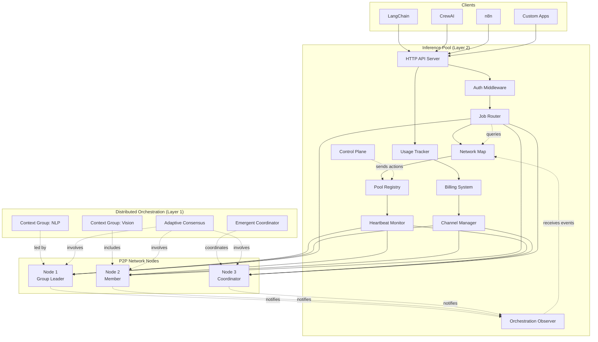
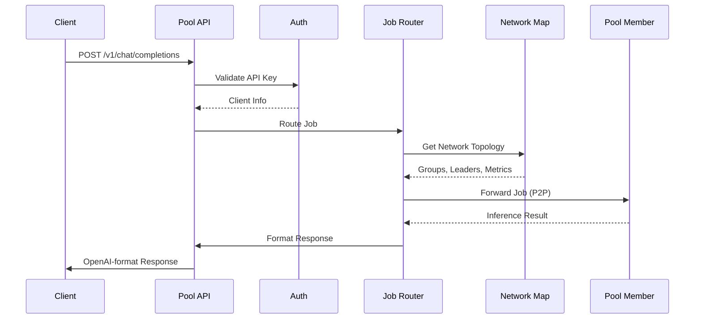
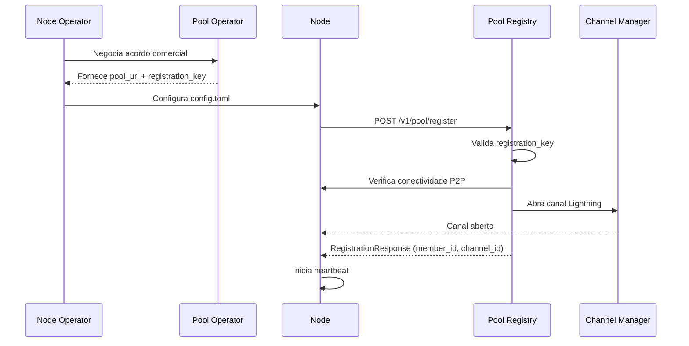
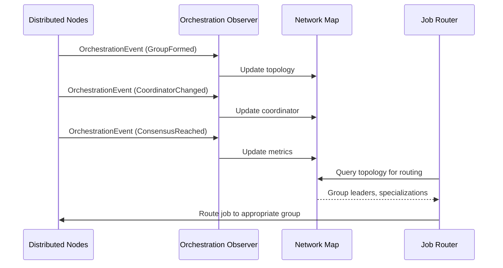
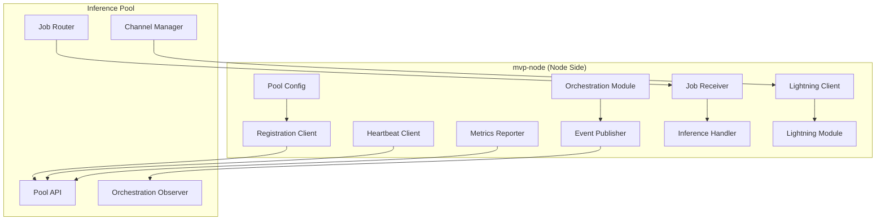

# Design Document: Inference Pool

## Overview

A Inference Pool é um componente Layer 2 que atua como agregador de nodes da rede P2P de IA descentralizada. Ela expõe uma API HTTP compatível com OpenAI, permitindo que desenvolvedores utilizem frameworks como LangChain, CrewAI e n8n sem modificações. A pool gerencia um conjunto de Pool_Members (nodes registrados manualmente), distribui jobs de forma inteligente, e oferece um modelo econômico onde Pool_Operators podem cobrar taxas por facilitar o acesso à rede.

**Modelo de Operação:**
- Operadores de nodes escolhem pool via acordo comercial (não há descoberta automática)
- Nodes se registram manualmente via configuração (pool fornece credenciais)
- Pool monitora orquestração distribuída que acontece entre nodes
- Pool visualiza papéis (coordenadores, líderes de grupo), grupos de contexto, e métricas
- Pool respeita decisões da rede P2P (consenso adaptativo, formação de grupos)

### Princípios de Design

1. **Compatibilidade OpenAI**: Endpoints seguem exatamente a especificação da API OpenAI
2. **Descentralização Preservada**: Qualquer entidade pode operar uma pool independente
3. **Transparência**: Status, capacidades, taxas e topologia da rede são públicos
4. **Resiliência**: Failover automático entre Pool_Members
5. **Observação Ativa**: Pool monitora mas não controla a orquestração distribuída

## Architecture



### Fluxo de Requisição



### Fluxo de Registro de Node



### Fluxo de Monitoramento de Orquestração



## Components and Interfaces

### 1. HTTP API Server

Servidor HTTP assíncrono que expõe endpoints compatíveis com OpenAI.

```rust
/// Configuration for the HTTP API server
pub struct ApiServerConfig {
    pub listen_addr: SocketAddr,
    pub tls_config: Option<TlsConfig>,
    pub max_connections: usize,
    pub request_timeout_ms: u64,
}

/// HTTP API Server trait
#[async_trait]
pub trait ApiServer: Send + Sync {
    /// Start the API server
    async fn start(&self, config: ApiServerConfig) -> Result<()>;
    
    /// Graceful shutdown
    async fn shutdown(&self) -> Result<()>;
    
    /// Get server metrics
    fn get_metrics(&self) -> ServerMetrics;
}
```

### 2. Pool Registry

Gerencia o registro de Pool_Members e suas capacidades.

```rust
/// Pool member information
#[derive(Debug, Clone, Serialize, Deserialize)]
pub struct PoolMember {
    pub node_id: String,
    pub peer_id: PeerId,
    pub capabilities: NodeCapabilities,
    pub models: Vec<ModelInfo>,
    pub status: MemberStatus,
    pub last_heartbeat: DateTime<Utc>,
    pub metrics: MemberMetrics,
}

/// Member status
#[derive(Debug, Clone, Serialize, Deserialize, PartialEq)]
pub enum MemberStatus {
    Active,
    Inactive,
    Draining,
}

/// Member performance metrics
#[derive(Debug, Clone, Serialize, Deserialize, Default)]
pub struct MemberMetrics {
    pub avg_latency_ms: f64,
    pub success_rate: f64,
    pub current_load: f64,
    pub jobs_completed: u64,
    pub tokens_processed: u64,
}

/// Pool Registry trait
#[async_trait]
pub trait PoolRegistry: Send + Sync {
    /// Register a new node as pool member
    async fn register_member(&self, registration: MemberRegistration) -> Result<PoolMember>;
    
    /// Update member status
    async fn update_member_status(&self, node_id: &str, status: MemberStatus) -> Result<()>;
    
    /// Get all active members
    fn get_active_members(&self) -> Vec<PoolMember>;
    
    /// Get members supporting a specific model
    fn get_members_for_model(&self, model: &str) -> Vec<PoolMember>;
    
    /// Remove a member from the pool
    async fn remove_member(&self, node_id: &str) -> Result<()>;
    
    /// Update member metrics
    async fn update_member_metrics(&self, node_id: &str, metrics: MemberMetrics) -> Result<()>;
}
```

### 3. Job Router

Distribui jobs entre Pool_Members de forma inteligente.

```rust
/// Routing strategy
#[derive(Debug, Clone)]
pub enum RoutingStrategy {
    RoundRobin,
    LeastLoaded,
    LowestLatency,
    WeightedScore,
}

/// Routing decision
#[derive(Debug, Clone)]
pub struct RoutingDecision {
    pub selected_member: PoolMember,
    pub strategy_used: RoutingStrategy,
    pub score: f64,
    pub alternatives: Vec<PoolMember>,
}

/// Job Router trait
#[async_trait]
pub trait JobRouter: Send + Sync {
    /// Route a job to an appropriate pool member
    async fn route_job(&self, job: &InferenceJob) -> Result<RoutingDecision>;
    
    /// Execute job on selected member with retry logic
    async fn execute_with_retry(
        &self,
        job: &InferenceJob,
        max_retries: u32,
    ) -> Result<InferenceResult>;
    
    /// Update routing metrics after job completion
    async fn record_job_result(&self, node_id: &str, success: bool, latency_ms: u64) -> Result<()>;
    
    /// Set routing strategy
    fn set_strategy(&mut self, strategy: RoutingStrategy);
}
```

### 4. Authentication Middleware

Valida API Keys e associa requisições a clientes.

```rust
/// API Key information
#[derive(Debug, Clone, Serialize, Deserialize)]
pub struct ApiKeyInfo {
    pub key_id: String,
    pub client_id: String,
    pub tier: SlaTier,
    pub rate_limit: RateLimit,
    pub created_at: DateTime<Utc>,
    pub expires_at: Option<DateTime<Utc>>,
}

/// SLA Tier
#[derive(Debug, Clone, Serialize, Deserialize, PartialEq)]
pub enum SlaTier {
    Free,
    Basic,
    Pro,
    Enterprise,
}

/// Rate limit configuration
#[derive(Debug, Clone, Serialize, Deserialize)]
pub struct RateLimit {
    pub requests_per_minute: u32,
    pub tokens_per_day: u64,
}

/// Auth Middleware trait
#[async_trait]
pub trait AuthMiddleware: Send + Sync {
    /// Validate an API key
    async fn validate_key(&self, api_key: &str) -> Result<ApiKeyInfo>;
    
    /// Check rate limit for a client
    async fn check_rate_limit(&self, client_id: &str) -> Result<bool>;
    
    /// Record API usage
    async fn record_usage(&self, client_id: &str, tokens: u64) -> Result<()>;
    
    /// Create a new API key
    async fn create_key(&self, client_id: &str, tier: SlaTier) -> Result<ApiKeyInfo>;
    
    /// Revoke an API key
    async fn revoke_key(&self, key_id: &str) -> Result<()>;
}
```

### 5. Usage Tracker

Rastreia uso por cliente para billing.

```rust
/// Usage record
#[derive(Debug, Clone, Serialize, Deserialize)]
pub struct UsageRecord {
    pub client_id: String,
    pub timestamp: DateTime<Utc>,
    pub model: String,
    pub prompt_tokens: u64,
    pub completion_tokens: u64,
    pub total_tokens: u64,
    pub cost: f64,
}

/// Usage summary
#[derive(Debug, Clone, Serialize, Deserialize)]
pub struct UsageSummary {
    pub client_id: String,
    pub period_start: DateTime<Utc>,
    pub period_end: DateTime<Utc>,
    pub total_requests: u64,
    pub total_tokens: u64,
    pub total_cost: f64,
    pub by_model: HashMap<String, ModelUsage>,
}

/// Usage Tracker trait
#[async_trait]
pub trait UsageTracker: Send + Sync {
    /// Record a completed inference
    async fn record_inference(&self, record: UsageRecord) -> Result<()>;
    
    /// Get usage summary for a client
    async fn get_usage_summary(
        &self,
        client_id: &str,
        start: DateTime<Utc>,
        end: DateTime<Utc>,
    ) -> Result<UsageSummary>;
    
    /// Calculate pool fee for an inference
    fn calculate_fee(&self, tokens: u64, tier: &SlaTier) -> f64;
}
```

### 6. Heartbeat Monitor

Monitora disponibilidade dos Pool_Members.

```rust
/// Heartbeat configuration
pub struct HeartbeatConfig {
    pub interval_ms: u64,
    pub timeout_ms: u64,
    pub max_missed: u32,
}

/// Heartbeat Monitor trait
#[async_trait]
pub trait HeartbeatMonitor: Send + Sync {
    /// Start monitoring a member
    async fn start_monitoring(&self, member: &PoolMember) -> Result<()>;
    
    /// Stop monitoring a member
    async fn stop_monitoring(&self, node_id: &str) -> Result<()>;
    
    /// Process heartbeat response
    async fn process_heartbeat(&self, node_id: &str, latency_ms: u64) -> Result<()>;
    
    /// Get members that missed heartbeats
    fn get_unhealthy_members(&self) -> Vec<String>;
}
```

### 7. Network Map

Mantém visualização da topologia da rede e papéis dos nodes na orquestração distribuída.

```rust
/// Mapa da topologia da rede que Pool mantém
#[derive(Debug, Clone, Serialize, Deserialize)]
pub struct NetworkMap {
    /// Nodes registrados na pool
    pub members: HashMap<String, PoolMember>,
    
    /// Coordenador emergente atual
    pub current_coordinator: Option<String>,
    pub coordinator_affinity: f64,
    
    /// Grupos de contexto ativos
    pub context_groups: HashMap<String, ContextGroup>,
    
    /// Conexões P2P entre nodes
    pub connections: Vec<NodeConnection>,
    
    /// Métricas agregadas
    pub metrics: NetworkMetrics,
    
    /// Histórico de eventos (últimos 1000)
    pub event_history: VecDeque<OrchestrationEvent>,
    
    /// Última atualização
    pub last_updated: DateTime<Utc>,
}

/// Grupo de contexto ativo
#[derive(Debug, Clone, Serialize, Deserialize)]
pub struct ContextGroup {
    pub group_id: String,
    pub context: String,
    pub leader: String,
    pub members: Vec<String>,
    pub specialization: Vec<String>,
    pub formed_at: DateTime<Utc>,
    pub jobs_processed: u64,
    pub avg_latency_ms: f64,
    pub status: GroupStatus,
}

#[derive(Debug, Clone, Serialize, Deserialize, PartialEq)]
pub enum GroupStatus {
    Active,
    Forming,
    Dissolving,
    Inactive,
}

/// Conexão P2P entre nodes
#[derive(Debug, Clone, Serialize, Deserialize)]
pub struct NodeConnection {
    pub from_node: String,
    pub to_node: String,
    pub latency_ms: f64,
    pub messages_exchanged: u64,
    pub last_seen: DateTime<Utc>,
}

/// Métricas agregadas da rede
#[derive(Debug, Clone, Serialize, Deserialize, Default)]
pub struct NetworkMetrics {
    pub total_nodes: u32,
    pub active_coordinators: u32,
    pub active_groups: u32,
    pub consensus_rounds_avg: f64,
    pub decision_latency_avg_ms: f64,
    pub partition_events: u32,
    pub consensus_success_rate: f64,
}

/// Network Map trait
#[async_trait]
pub trait NetworkMapTrait: Send + Sync {
    /// Get current network topology
    fn get_topology(&self) -> NetworkMap;
    
    /// Get context groups
    fn get_context_groups(&self) -> Vec<ContextGroup>;
    
    /// Get current coordinator
    fn get_current_coordinator(&self) -> Option<String>;
    
    /// Get group by context
    fn get_group_by_context(&self, context: &str) -> Option<ContextGroup>;
    
    /// Get nodes in a group
    fn get_group_members(&self, group_id: &str) -> Vec<PoolMember>;
    
    /// Update topology from event
    async fn update_from_event(&mut self, event: OrchestrationEvent) -> Result<()>;
    
    /// Get event history
    fn get_event_history(&self, limit: usize) -> Vec<OrchestrationEvent>;
}
```

### 8. Orchestration Observer

Monitora eventos da orquestração distribuída e atualiza Network Map.

```rust
/// Eventos da orquestração distribuída que Pool monitora
#[derive(Debug, Clone, Serialize, Deserialize)]
pub enum OrchestrationEvent {
    /// Coordenador emergente mudou
    CoordinatorChanged {
        old_coordinator: Option<String>,
        new_coordinator: String,
        affinity_score: f64,
        reason: CoordinatorChangeReason,
        timestamp: DateTime<Utc>,
    },
    
    /// Grupo de contexto foi formado
    ContextGroupFormed {
        group_id: String,
        context: String,
        leader: String,
        members: Vec<String>,
        specialization: Vec<String>,
        timestamp: DateTime<Utc>,
    },
    
    /// Grupo de contexto foi dissolvido
    ContextGroupDissolved {
        group_id: String,
        reason: String,
        timestamp: DateTime<Utc>,
    },
    
    /// Líder de grupo mudou
    GroupLeaderChanged {
        group_id: String,
        old_leader: Option<String>,
        new_leader: String,
        timestamp: DateTime<Utc>,
    },
    
    /// Consenso foi alcançado
    ConsensusReached {
        decision_id: String,
        decision_type: String,
        participants: Vec<String>,
        rounds: u32,
        confidence: f64,
        timestamp: DateTime<Utc>,
    },
    
    /// Node mudou de papel
    NodeRoleChanged {
        node_id: String,
        old_role: NodeRole,
        new_role: NodeRole,
        timestamp: DateTime<Utc>,
    },
    
    /// Partição de rede detectada
    NetworkPartitionDetected {
        partition_id: String,
        affected_nodes: Vec<String>,
        timestamp: DateTime<Utc>,
    },
    
    /// Partição de rede resolvida
    NetworkPartitionResolved {
        partition_id: String,
        timestamp: DateTime<Utc>,
    },
}

#[derive(Debug, Clone, Serialize, Deserialize, PartialEq)]
pub enum NodeRole {
    Regular,
    EmergentCoordinator,
    GroupLeader { group_id: String },
    MultiRole { roles: Vec<String> },
}

#[derive(Debug, Clone, Serialize, Deserialize)]
pub enum CoordinatorChangeReason {
    AffinityChange,
    NodeFailure,
    PeriodicRotation,
    LoadBalancing,
}

/// Orchestration Observer trait
#[async_trait]
pub trait OrchestrationObserver: Send + Sync {
    /// Start observing orchestration events
    async fn start(&mut self) -> Result<()>;
    
    /// Recebe notificação de evento via P2P
    async fn on_orchestration_event(&self, event: OrchestrationEvent) -> Result<()>;
    
    /// Recebe atualização de métricas de um node
    async fn on_metrics_update(&self, node_id: &str, metrics: NodeMetrics) -> Result<()>;
    
    /// Recebe atualização de topologia
    async fn on_topology_change(&self, change: TopologyChange) -> Result<()>;
    
    /// Get network map reference
    fn get_network_map(&self) -> &dyn NetworkMapTrait;
    
    /// Shutdown observer
    async fn shutdown(&mut self) -> Result<()>;
}

#[derive(Debug, Clone, Serialize, Deserialize)]
pub enum TopologyChange {
    NodeAdded { node_id: String },
    NodeRemoved { node_id: String },
    ConnectionEstablished { from: String, to: String },
    ConnectionLost { from: String, to: String },
}
```

### 9. Pool Control Plane

Permite Pool tomar ações baseadas no estado da rede.

```rust
/// Critérios de saúde do node
#[derive(Debug, Clone, Serialize, Deserialize)]
pub struct NodeHealthCheck {
    pub node_id: String,
    pub success_rate: f64,
    pub avg_latency_ms: f64,
    pub uptime_percent: f64,
    pub consensus_participation: f64,
    pub last_heartbeat: DateTime<Utc>,
    pub jobs_completed: u64,
    pub jobs_failed: u64,
}

/// Razão de desregistro
#[derive(Debug, Clone, Serialize, Deserialize)]
pub enum DeregistrationReason {
    LowSuccessRate { rate: f64 },
    LowUptime { uptime: f64 },
    HighLatency { latency_ms: f64 },
    LowConsensusParticipation { participation: f64 },
    ManualDeregistration { reason: String },
    ContractViolation { details: String },
}

/// Pool Control Plane trait
#[async_trait]
pub trait PoolControlPlane: Send + Sync {
    /// Avaliar saúde de um node
    async fn evaluate_node_health(&self, node_id: &str) -> Result<NodeHealthCheck>;
    
    /// Verificar se node deve ser desregistrado
    fn should_deregister(&self, health: &NodeHealthCheck) -> Option<DeregistrationReason>;
    
    /// Desregistrar node com baixa performance
    async fn deregister_node(&self, node_id: &str, reason: DeregistrationReason) -> Result<()>;
    
    /// Enviar warning ao operador do node
    async fn send_node_warning(&self, node_id: &str, message: &str) -> Result<()>;
    
    /// Ajustar fee baseado em performance do node
    async fn adjust_node_fee(&self, node_id: &str, new_fee_percent: f64) -> Result<()>;
    
    /// Priorizar node para jobs específicos
    async fn set_node_priority(&self, node_id: &str, priority: u32) -> Result<()>;
    
    /// Get nodes at risk (baixa performance)
    fn get_at_risk_nodes(&self) -> Vec<(String, DeregistrationReason)>;
}
```

### 10. Pool Orchestrator (LLM-Powered)

Usa LLM local para decisões inteligentes de roteamento complexo, respeitando decisões da orquestração distribuída.

```rust
/// Orchestration decision type
#[derive(Debug, Clone, Serialize, Deserialize)]
pub enum DecisionType {
    Routing,
    LoadBalancing,
    ResourceAllocation,
    Optimization,
    Anomaly,
}

/// Orchestration context for LLM
#[derive(Debug, Clone, Serialize, Deserialize)]
pub struct OrchestrationContext {
    pub decision_type: DecisionType,
    pub current_metrics: PoolMetrics,
    pub member_states: Vec<MemberState>,
    pub pending_jobs: Vec<JobSummary>,
    pub client_sla: Option<SlaTier>,
    pub historical_data: Option<HistoricalMetrics>,
    pub network_map: Option<NetworkMap>,  // Topologia da rede
}

/// LLM decision response
#[derive(Debug, Clone, Serialize, Deserialize)]
pub struct OrchestratorDecision {
    pub decision_id: String,
    pub decision_type: DecisionType,
    pub recommendation: String,
    pub confidence: f64,
    pub reasoning: String,
    pub actions: Vec<OrchestratorAction>,
    pub respects_network_decision: bool,  // Se respeita decisão da rede
    pub timestamp: DateTime<Utc>,
}

/// Action recommended by orchestrator
#[derive(Debug, Clone, Serialize, Deserialize)]
pub enum OrchestratorAction {
    RouteToMember { member_id: String, priority: u32 },
    RouteToGroup { group_id: String, context: String },  // Rotear para grupo de contexto
    DeferToNetwork { reason: String },  // Deixar rede decidir
    ScaleUp { model: String, target_capacity: u32 },
    ScaleDown { member_id: String },
    AlertOperator { message: String, severity: String },
    AdjustRateLimit { client_id: String, new_limit: RateLimit },
}

/// Pool Orchestrator trait
#[async_trait]
pub trait PoolOrchestrator: Send + Sync {
    /// Initialize orchestrator with LLM backend
    async fn initialize(&mut self, llm_config: LlmConfig) -> Result<()>;
    
    /// Request routing decision from LLM (considera network map)
    async fn get_routing_decision(&self, context: &OrchestrationContext) -> Result<OrchestratorDecision>;
    
    /// Analyze metrics and suggest optimizations
    async fn analyze_performance(&self, metrics: &PoolMetrics) -> Result<Vec<OrchestratorDecision>>;
    
    /// Plan resource allocation for SLA requirements
    async fn plan_allocation(&self, client_id: &str, sla: &SlaTier) -> Result<OrchestratorDecision>;
    
    /// Check if should defer to network decision
    fn should_defer_to_network(&self, context: &OrchestrationContext) -> bool;
    
    /// Record decision outcome for future fine-tuning
    async fn record_outcome(&self, decision_id: &str, success: bool, metrics: &ExecutionMetrics) -> Result<()>;
    
    /// Get decision history
    fn get_decision_history(&self, limit: usize) -> Vec<OrchestratorDecision>;
}
```

### 11. Billing System

Sistema completo de bilhetagem para clientes e Pool_Members com pagamentos instantâneos via canais Lightning diretos.

```rust
/// Billing ticket for a single inference
#[derive(Debug, Clone, Serialize, Deserialize)]
pub struct BillingTicket {
    pub ticket_id: String,
    pub client_id: String,
    pub member_id: String,
    pub job_id: String,
    pub timestamp: DateTime<Utc>,
    pub model: String,
    pub tokens: TokenUsage,
    pub client_cost: Money,
    pub member_payment: Money,
    pub pool_fee: Money,
    pub payment_status: PaymentStatus,
    pub channel_id: Option<String>,
}

/// Token usage breakdown
#[derive(Debug, Clone, Serialize, Deserialize)]
pub struct TokenUsage {
    pub prompt_tokens: u64,
    pub completion_tokens: u64,
    pub total_tokens: u64,
}

/// Money representation with currency
#[derive(Debug, Clone, Serialize, Deserialize)]
pub struct Money {
    pub amount: f64,
    pub currency: Currency,
}

/// Supported currencies
#[derive(Debug, Clone, Serialize, Deserialize, PartialEq)]
pub enum Currency {
    USD,
    EUR,
    BRL,
    BTC,
    SATS,  // Lightning Network satoshis
}

/// Payment status
#[derive(Debug, Clone, Serialize, Deserialize, PartialEq)]
pub enum PaymentStatus {
    Pending,
    Paid,
    Failed,
    Disputed,
}

/// Client invoice
#[derive(Debug, Clone, Serialize, Deserialize)]
pub struct Invoice {
    pub invoice_id: String,
    pub client_id: String,
    pub period_start: DateTime<Utc>,
    pub period_end: DateTime<Utc>,
    pub tickets: Vec<String>,  // ticket_ids
    pub subtotal: Money,
    pub tax: Option<Money>,
    pub total: Money,
    pub status: InvoiceStatus,
    pub due_date: DateTime<Utc>,
    pub payment_methods: Vec<PaymentMethod>,
}

/// Invoice status
#[derive(Debug, Clone, Serialize, Deserialize, PartialEq)]
pub enum InvoiceStatus {
    Draft,
    Issued,
    Paid,
    Overdue,
    Cancelled,
}

/// Payment method
#[derive(Debug, Clone, Serialize, Deserialize)]
pub enum PaymentMethod {
    CreditCard,
    BankTransfer,
    Lightning { invoice: String },
    DirectChannel { channel_id: String, node_pubkey: String },
    OnChain { address: String },
}

/// Member earnings summary
#[derive(Debug, Clone, Serialize, Deserialize)]
pub struct MemberEarnings {
    pub member_id: String,
    pub period_start: DateTime<Utc>,
    pub period_end: DateTime<Utc>,
    pub total_jobs: u64,
    pub total_tokens: u64,
    pub gross_earnings: Money,
    pub pool_fees_paid: Money,
    pub net_earnings: Money,
    pub payments_received: Vec<PaymentRecord>,
}

/// Payment record
#[derive(Debug, Clone, Serialize, Deserialize)]
pub struct PaymentRecord {
    pub payment_id: String,
    pub timestamp: DateTime<Utc>,
    pub amount: Money,
    pub method: PaymentMethod,
    pub ticket_ids: Vec<String>,
}

/// Billing System trait
#[async_trait]
pub trait BillingSystem: Send + Sync {
    /// Create a billing ticket for completed inference
    async fn create_ticket(&self, job_result: &JobResult, client_id: &str, member_id: &str) -> Result<BillingTicket>;
    
    /// Calculate fee split between pool and member
    fn calculate_split(&self, total: &Money, tier: &SlaTier) -> (Money, Money);
    
    /// Process instant payment to member via direct channel
    async fn pay_member_instant(&self, ticket: &BillingTicket) -> Result<PaymentRecord>;
    
    /// Get client invoices
    async fn get_client_invoices(&self, client_id: &str, status: Option<InvoiceStatus>) -> Result<Vec<Invoice>>;
    
    /// Get member earnings
    async fn get_member_earnings(&self, member_id: &str, start: DateTime<Utc>, end: DateTime<Utc>) -> Result<MemberEarnings>;
    
    /// Generate invoice for billing period
    async fn generate_invoice(&self, client_id: &str, period_end: DateTime<Utc>) -> Result<Invoice>;
    
    /// Process payment
    async fn process_payment(&self, invoice_id: &str, method: &PaymentMethod) -> Result<()>;
    
    /// Generate Lightning invoice for payment
    async fn generate_lightning_invoice(&self, amount: &Money) -> Result<String>;
}
```

### 12. Channel Manager

Gerencia canais Lightning diretos entre Pool e Pool_Members para pagamentos instantâneos sem fees.

```rust
/// Lightning channel information
#[derive(Debug, Clone, Serialize, Deserialize)]
pub struct LightningChannel {
    pub channel_id: String,
    pub member_id: String,
    pub node_pubkey: String,
    pub capacity_sats: u64,
    pub local_balance_sats: u64,
    pub remote_balance_sats: u64,
    pub status: ChannelStatus,
    pub opened_at: DateTime<Utc>,
    pub last_payment: Option<DateTime<Utc>>,
    pub total_payments: u64,
    pub total_sats_sent: u64,
}

/// Channel status
#[derive(Debug, Clone, Serialize, Deserialize, PartialEq)]
pub enum ChannelStatus {
    Opening,
    Active,
    Inactive,
    Closing,
    Closed,
}

/// Channel configuration
#[derive(Debug, Clone, Serialize, Deserialize)]
pub struct ChannelConfig {
    pub default_capacity_sats: u64,
    pub min_local_balance_sats: u64,
    pub rebalance_threshold: f64,
    pub auto_rebalance: bool,
}

/// Channel metrics
#[derive(Debug, Clone, Serialize, Deserialize)]
pub struct ChannelMetrics {
    pub total_channels: u32,
    pub active_channels: u32,
    pub total_capacity_sats: u64,
    pub total_local_balance_sats: u64,
    pub avg_utilization: f64,
    pub payments_last_24h: u64,
}

/// Channel Manager trait
#[async_trait]
pub trait ChannelManager: Send + Sync {
    /// Open a direct Lightning channel with a Pool_Member
    async fn open_channel(&self, member_id: &str, node_pubkey: &str, capacity_sats: u64) -> Result<LightningChannel>;
    
    /// Send instant payment via direct channel
    async fn send_payment(&self, channel_id: &str, amount_sats: u64, memo: &str) -> Result<String>;
    
    /// Get channel information
    async fn get_channel(&self, channel_id: &str) -> Result<LightningChannel>;
    
    /// Get all channels for a member
    async fn get_member_channels(&self, member_id: &str) -> Result<Vec<LightningChannel>>;
    
    /// Monitor channel liquidity and rebalance if needed
    async fn check_and_rebalance(&self, channel_id: &str) -> Result<()>;
    
    /// Close a channel cooperatively
    async fn close_channel(&self, channel_id: &str) -> Result<()>;
    
    /// Get channel metrics
    fn get_metrics(&self) -> ChannelMetrics;
    
    /// Handle channel events (opened, closed, payment received)
    async fn handle_channel_event(&self, event: ChannelEvent) -> Result<()>;
}

/// Channel event
#[derive(Debug, Clone, Serialize, Deserialize)]
pub enum ChannelEvent {
    Opened { channel_id: String, member_id: String },
    Closed { channel_id: String, reason: String },
    PaymentSent { channel_id: String, amount_sats: u64 },
    PaymentReceived { channel_id: String, amount_sats: u64 },
    LowLiquidity { channel_id: String, balance_sats: u64 },
}
```

## Data Models

### OpenAI-Compatible Request/Response

```rust
/// Chat completion request (OpenAI format)
#[derive(Debug, Clone, Serialize, Deserialize)]
pub struct ChatCompletionRequest {
    pub model: String,
    pub messages: Vec<ChatMessage>,
    #[serde(default)]
    pub temperature: Option<f32>,
    #[serde(default)]
    pub max_tokens: Option<u32>,
    #[serde(default)]
    pub stream: bool,
    #[serde(default)]
    pub top_p: Option<f32>,
    #[serde(default)]
    pub frequency_penalty: Option<f32>,
    #[serde(default)]
    pub presence_penalty: Option<f32>,
    #[serde(default)]
    pub stop: Option<Vec<String>>,
    #[serde(default)]
    pub user: Option<String>,
}

/// Chat message
#[derive(Debug, Clone, Serialize, Deserialize)]
pub struct ChatMessage {
    pub role: MessageRole,
    pub content: String,
    #[serde(skip_serializing_if = "Option::is_none")]
    pub name: Option<String>,
}

/// Message role
#[derive(Debug, Clone, Serialize, Deserialize, PartialEq)]
#[serde(rename_all = "lowercase")]
pub enum MessageRole {
    System,
    User,
    Assistant,
}

/// Chat completion response (OpenAI format)
#[derive(Debug, Clone, Serialize, Deserialize)]
pub struct ChatCompletionResponse {
    pub id: String,
    pub object: String,
    pub created: i64,
    pub model: String,
    pub choices: Vec<ChatChoice>,
    pub usage: Usage,
}

/// Chat choice
#[derive(Debug, Clone, Serialize, Deserialize)]
pub struct ChatChoice {
    pub index: u32,
    pub message: ChatMessage,
    pub finish_reason: Option<String>,
}

/// Token usage
#[derive(Debug, Clone, Serialize, Deserialize)]
pub struct Usage {
    pub prompt_tokens: u64,
    pub completion_tokens: u64,
    pub total_tokens: u64,
}

/// Embedding request
#[derive(Debug, Clone, Serialize, Deserialize)]
pub struct EmbeddingRequest {
    pub model: String,
    pub input: EmbeddingInput,
    #[serde(default)]
    pub encoding_format: Option<String>,
}

/// Embedding input (string or array)
#[derive(Debug, Clone, Serialize, Deserialize)]
#[serde(untagged)]
pub enum EmbeddingInput {
    Single(String),
    Multiple(Vec<String>),
}

/// Embedding response
#[derive(Debug, Clone, Serialize, Deserialize)]
pub struct EmbeddingResponse {
    pub object: String,
    pub data: Vec<EmbeddingData>,
    pub model: String,
    pub usage: EmbeddingUsage,
}

/// Embedding data
#[derive(Debug, Clone, Serialize, Deserialize)]
pub struct EmbeddingData {
    pub object: String,
    pub embedding: Vec<f32>,
    pub index: u32,
}

/// Embedding usage
#[derive(Debug, Clone, Serialize, Deserialize)]
pub struct EmbeddingUsage {
    pub prompt_tokens: u64,
    pub total_tokens: u64,
}

/// Models list response
#[derive(Debug, Clone, Serialize, Deserialize)]
pub struct ModelsResponse {
    pub object: String,
    pub data: Vec<ModelObject>,
}

/// Model object
#[derive(Debug, Clone, Serialize, Deserialize)]
pub struct ModelObject {
    pub id: String,
    pub object: String,
    pub created: i64,
    pub owned_by: String,
    #[serde(skip_serializing_if = "Option::is_none")]
    pub pool_info: Option<PoolModelInfo>,
}

/// Pool-specific model info
#[derive(Debug, Clone, Serialize, Deserialize)]
pub struct PoolModelInfo {
    pub node_count: u32,
    pub total_capacity: u32,
    pub avg_latency_ms: f64,
}
```

### Error Response

```rust
/// OpenAI-compatible error response
#[derive(Debug, Clone, Serialize, Deserialize)]
pub struct ErrorResponse {
    pub error: ErrorDetail,
}

/// Error detail
#[derive(Debug, Clone, Serialize, Deserialize)]
pub struct ErrorDetail {
    pub message: String,
    #[serde(rename = "type")]
    pub error_type: String,
    #[serde(skip_serializing_if = "Option::is_none")]
    pub param: Option<String>,
    #[serde(skip_serializing_if = "Option::is_none")]
    pub code: Option<String>,
}

/// Error types
pub enum PoolErrorType {
    InvalidRequestError,
    AuthenticationError,
    RateLimitError,
    ModelNotFound,
    ServiceUnavailable,
    InternalError,
}

impl PoolErrorType {
    pub fn as_str(&self) -> &'static str {
        match self {
            Self::InvalidRequestError => "invalid_request_error",
            Self::AuthenticationError => "authentication_error",
            Self::RateLimitError => "rate_limit_error",
            Self::ModelNotFound => "model_not_found",
            Self::ServiceUnavailable => "service_unavailable",
            Self::InternalError => "internal_error",
        }
    }
    
    pub fn status_code(&self) -> u16 {
        match self {
            Self::InvalidRequestError => 400,
            Self::AuthenticationError => 401,
            Self::RateLimitError => 429,
            Self::ModelNotFound => 404,
            Self::ServiceUnavailable => 503,
            Self::InternalError => 500,
        }
    }
}
```

### Pool Status

```rust
/// Pool status response
#[derive(Debug, Clone, Serialize, Deserialize)]
pub struct PoolStatus {
    pub pool_id: String,
    pub active_members: u32,
    pub total_capacity: u32,
    pub models_available: Vec<String>,
    pub avg_latency_ms: f64,
    pub requests_per_minute: f64,
    pub uptime_percentage: f64,
}

/// Pool info response (público, para marketing)
#[derive(Debug, Clone, Serialize, Deserialize)]
pub struct PoolInfo {
    pub pool_id: String,
    pub name: String,
    pub description: String,
    pub operator: String,
    pub fee_structure: FeeStructure,
    pub sla_tiers: Vec<SlaTierInfo>,
    pub policies: PoolPolicies,
    pub registration_endpoint: String,  // URL para registro
}

/// Network map response (topologia da rede)
#[derive(Debug, Clone, Serialize, Deserialize)]
pub struct NetworkMapResponse {
    pub current_coordinator: Option<String>,
    pub coordinator_affinity: f64,
    pub total_nodes: u32,
    pub active_groups: u32,
    pub context_groups: Vec<ContextGroupInfo>,
    pub network_health: NetworkHealthInfo,
    pub last_updated: DateTime<Utc>,
}

/// Context group info (para visualização)
#[derive(Debug, Clone, Serialize, Deserialize)]
pub struct ContextGroupInfo {
    pub group_id: String,
    pub context: String,
    pub leader: String,
    pub member_count: u32,
    pub specialization: Vec<String>,
    pub jobs_processed: u64,
    pub avg_latency_ms: f64,
    pub status: GroupStatus,
}

/// Network health info
#[derive(Debug, Clone, Serialize, Deserialize)]
pub struct NetworkHealthInfo {
    pub consensus_success_rate: f64,
    pub avg_consensus_rounds: f64,
    pub partition_events_last_24h: u32,
    pub coordinator_rotations_last_24h: u32,
}

/// Orchestration events response
#[derive(Debug, Clone, Serialize, Deserialize)]
pub struct OrchestrationEventsResponse {
    pub events: Vec<OrchestrationEvent>,
    pub total_count: u64,
    pub page: u32,
    pub page_size: u32,
}

/// Fee structure
#[derive(Debug, Clone, Serialize, Deserialize)]
pub struct FeeStructure {
    pub base_fee_per_1k_tokens: f64,
    pub currency: String,
    pub tier_multipliers: HashMap<String, f64>,
}

/// SLA tier info
#[derive(Debug, Clone, Serialize, Deserialize)]
pub struct SlaTierInfo {
    pub tier: SlaTier,
    pub max_latency_ms: u64,
    pub availability_sla: f64,
    pub priority: u32,
}

/// Pool policies
#[derive(Debug, Clone, Serialize, Deserialize)]
pub struct PoolPolicies {
    pub max_request_size_bytes: u64,
    pub max_tokens_per_request: u64,
    pub supported_models: Vec<String>,
    pub rate_limits: HashMap<String, RateLimit>,
}
```

### Registration API

```rust
/// Node registration request
#[derive(Debug, Clone, Serialize, Deserialize)]
pub struct PoolRegistrationRequest {
    pub registration_key: String,
    pub node_id: String,
    pub peer_id: String,
    pub capabilities: NodeCapabilities,
    pub models: Vec<ModelInfo>,
    pub lightning_pubkey: String,
    pub multiaddrs: Vec<String>,
}

/// Registration response
#[derive(Debug, Clone, Serialize, Deserialize)]
pub struct RegistrationResponse {
    pub status: String,  // "accepted" | "rejected"
    pub member_id: String,
    pub channel_id: Option<String>,
    pub pool_info: PoolInfo,
    pub message: Option<String>,
}
```


## Correctness Properties

*A property is a characteristic or behavior that should hold true across all valid executions of a system—essentially, a formal statement about what the system should do. Properties serve as the bridge between human-readable specifications and machine-verifiable correctness guarantees.*


### Property 1: Node Registration Round-Trip

*For any* valid node registration with capabilities (models, GPU, memory), registering the node and then querying the registry SHALL return the same capabilities that were registered.

**Validates: Requirements 1.1, 1.2**

### Property 2: Heartbeat Timeout Marks Inactive

*For any* Pool_Member that misses heartbeats for the configured timeout period, the Pool_Registry SHALL mark that member as inactive.

**Validates: Requirements 1.3, 1.4**

### Property 3: OpenAI Request Format Acceptance

*For any* valid OpenAI-format chat completion request, the Inference_Pool SHALL accept the payload without format errors.

**Validates: Requirements 2.1**

### Property 4: Message Roles Parsing

*For any* messages array containing roles (system, user, assistant), the Inference_Pool SHALL correctly parse and preserve all message roles and content.

**Validates: Requirements 2.2**

### Property 5: Streaming Mode Determines Response Format

*For any* chat completion request, if `stream: true` the response SHALL be SSE format, otherwise the response SHALL be complete JSON.

**Validates: Requirements 2.3, 2.4**

### Property 6: Response Contains Required OpenAI Fields

*For any* completed inference, the response SHALL contain `id`, `choices`, and `usage` fields in OpenAI-compatible format.

**Validates: Requirements 2.5**

### Property 7: Embedding Input Flexibility

*For any* embedding request, the input SHALL be accepted as either a single string or an array of strings.

**Validates: Requirements 3.1, 3.2**

### Property 8: Embedding Order Preservation

*For any* embedding request with N inputs, the response SHALL contain exactly N embeddings in the same order as the inputs.

**Validates: Requirements 3.3**

### Property 9: Models Aggregation from Members

*For any* set of active Pool_Members, the `/v1/models` endpoint SHALL return the union of all models supported by those members with accurate node counts.

**Validates: Requirements 4.1, 4.2**

### Property 10: Router Selects Model-Compatible Member

*For any* job requesting a specific model, the Job_Router SHALL only select Pool_Members that support that model.

**Validates: Requirements 5.1**

### Property 11: Router Considers Load and Latency

*For any* routing decision with multiple available members, members with lower load and latency SHALL have higher selection probability.

**Validates: Requirements 5.2**

### Property 12: Router Retries on Failure

*For any* job where the selected Pool_Member fails, the Job_Router SHALL retry on a different available member before returning an error.

**Validates: Requirements 5.3**

### Property 13: API Key Validation Determines Access

*For any* request, valid API keys SHALL grant access and invalid/missing keys SHALL return 401 Unauthorized.

**Validates: Requirements 6.1, 6.2, 6.3**

### Property 14: Inference Completion Triggers Tracking

*For any* completed inference, the Usage_Tracker SHALL record tokens consumed and calculate Pool_Fee based on the client's SLA_Tier.

**Validates: Requirements 7.1, 7.2**

### Property 15: Error Responses Follow OpenAI Format

*For any* error during processing, the response SHALL contain `error.message`, `error.type`, and `error.code` in OpenAI format.

**Validates: Requirements 9.1**

### Property 16: Invalid Payload Returns 400

*For any* request with invalid payload structure, the Inference_Pool SHALL return HTTP 400 with type `invalid_request_error`.

**Validates: Requirements 9.3**

### Property 17: Registration API Validates Key

*For any* node registration request, if the Registration_Key is invalid, the Pool SHALL return 401 Unauthorized; if valid, SHALL accept and return RegistrationResponse.

**Validates: Requirements 10.1, 10.2, 10.3**

### Property 18: Orchestration Events Update Network Map

*For any* OrchestrationEvent received from nodes, the Orchestration_Observer SHALL update the Network_Map with the new topology information.

**Validates: Requirements 11.1, 11.4**

### Property 19: Node Health Triggers Deregistration

*For any* node with success rate < 90% for 48h, the Pool_Control_Plane SHALL automatically deregister the node and close Lightning channel.

**Validates: Requirements 12.1, 12.3, 12.4**

### Property 20: Router Consults Network Map

*For any* job routing decision, the Job_Router SHALL query Network_Map to identify appropriate Context_Group or Group_Leader before routing.

**Validates: Requirements 13.1, 13.2**

### Property 21: LLM Respects Network Decisions

*For any* routing decision where orquestração distribuída already decided, the Pool_Orchestrator SHALL defer to network decision instead of overriding.

**Validates: Requirements 14.5**

### Property 22: Billing Ticket Creation

*For any* completed inference, the Billing_System SHALL create a ticket with accurate token counts, costs, and fee split.

**Validates: Requirements 15.1, 15.2**

### Property 23: Invoice Generation

*For any* billing period close, the Billing_System SHALL generate a consolidated invoice containing all tickets for that period.

**Validates: Requirements 15.5**

### Property 24: Multi-Currency Support

*For any* payment or payout, the Billing_System SHALL support the specified currency including Lightning Network satoshis.

**Validates: Requirements 15.6**

### Property 25: Direct Channel Opens on Registration

*For any* Pool_Member registration, the Channel_Manager SHALL attempt to open a direct Lightning channel with the node.

**Validates: Requirements 16.1**

### Property 26: Instant Payment via Direct Channel

*For any* completed inference with an active direct channel, the Channel_Manager SHALL send payment instantly to the Pool_Member without routing fees.

**Validates: Requirements 16.2**

### Property 27: Channel Liquidity Monitoring

*For any* active Lightning channel, if local balance falls below threshold, the Channel_Manager SHALL trigger rebalancing.

**Validates: Requirements 16.3**

### Property 28: Cooperative Channel Closure

*For any* Pool_Member leaving the pool, the Channel_Manager SHALL close the Lightning channel cooperatively.

**Validates: Requirements 16.4**

## Error Handling

### Error Categories

| Error Type | HTTP Status | Description |
|------------|-------------|-------------|
| `invalid_request_error` | 400 | Malformed request, missing required fields |
| `authentication_error` | 401 | Invalid or missing API key |
| `rate_limit_error` | 429 | Client exceeded rate limits |
| `model_not_found` | 404 | Requested model not available in pool |
| `service_unavailable` | 503 | No Pool_Members available |
| `internal_error` | 500 | Unexpected server error |

### Error Response Format

All errors follow OpenAI format:

```json
{
  "error": {
    "message": "Human-readable error description",
    "type": "error_type_string",
    "param": "field_name_if_applicable",
    "code": "specific_error_code"
  }
}
```

### Retry Strategy

1. **Member Failure**: Automatic retry on different member (max 3 attempts)
2. **Timeout**: Configurable per-request timeout with retry
3. **Rate Limit**: Return 429 with `Retry-After` header

## Testing Strategy

### Unit Tests

Unit tests verify specific examples and edge cases:

- API endpoint routing
- Request/response serialization
- Authentication validation
- Error formatting
- Fee calculation

### Property-Based Tests

Property-based tests verify universal properties using `proptest` crate:

- **Minimum 100 iterations** per property test
- Each test references its design document property
- Tag format: `Feature: api-integration, Property N: <property_text>`

### Test Categories

1. **API Compatibility Tests**: Verify OpenAI format compliance
2. **Registry Tests**: Member registration and status management
3. **Router Tests**: Job distribution and retry logic
4. **Auth Tests**: API key validation and rate limiting
5. **Usage Tests**: Token tracking and fee calculation
6. **Network Map Tests**: Topology visualization and event processing
7. **Orchestration Observer Tests**: Event monitoring and map updates
8. **Control Plane Tests**: Node health evaluation and deregistration
9. **Orchestrator Tests**: LLM decision making respecting network decisions
10. **Billing Tests**: Ticket creation, invoice generation, payment processing
11. **Channel Tests**: Lightning channel opening, payment sending, rebalancing, closure

### Integration Tests

- End-to-end request flow with mock nodes
- Streaming response handling
- Multi-member routing scenarios
- Failure and recovery scenarios
- Orchestration event flow (nodes → observer → network map → router)
- LLM orchestrator with mock LLM backend
- Billing flow from inference to Lightning payment
- Node health monitoring and automatic deregistration

---

## Node-Side Components

**IMPORTANTE**: Esta seção especifica componentes que devem ser implementados no **mvp-node** (código em `mvp-node/src/pool/`) para suportar integração com Inference Pools. Estes componentes são parte do mesmo design porque Pool e Node formam um sistema integrado.

**Localização**: Todos os componentes abaixo devem ser implementados em `mvp-node/src/pool/`

### Architecture Overview (Node Side)



### N1. Pool Configuration

**Por quê**: Node precisa saber qual pool usar e como se autenticar.

**Onde**: `mvp-node/src/pool/config.rs` + `mvp-node/config.toml`

Gerencia configuração de pool no node.

```rust
/// Pool configuration in config.toml
#[derive(Debug, Clone, Serialize, Deserialize)]
pub struct PoolConfig {
    /// Enable pool integration
    pub enabled: bool,
    
    /// Pool URL (e.g., "https://pool.example.com")
    pub pool_url: String,
    
    /// Registration key provided by pool operator
    pub registration_key: String,
    
    /// Auto-register on node startup
    pub auto_register: bool,
    
    /// Heartbeat interval in milliseconds
    pub heartbeat_interval_ms: u64,
    
    /// Metrics reporting interval in milliseconds
    pub metrics_interval_ms: u64,
    
    /// Retry configuration
    pub max_retries: u32,
    pub retry_delay_ms: u64,
}

impl Default for PoolConfig {
    fn default() -> Self {
        Self {
            enabled: false,
            pool_url: String::new(),
            registration_key: String::new(),
            auto_register: true,
            heartbeat_interval_ms: 30_000,  // 30s
            metrics_interval_ms: 300_000,   // 5min
            max_retries: 3,
            retry_delay_ms: 5_000,
        }
    }
}
```

**config.toml example**:
```toml
[pool]
enabled = true
pool_url = "https://pool.example.com"
registration_key = "secret-key-from-pool-operator"
auto_register = true
heartbeat_interval_ms = 30000
metrics_interval_ms = 300000
```

### N2. Registration Client

**Por quê**: Node precisa se registrar na pool para receber jobs e pagamentos.

**Onde**: `mvp-node/src/pool/registration.rs`

Cliente HTTP para registrar node na pool.

```rust
/// Registration request sent to pool
#[derive(Debug, Clone, Serialize, Deserialize)]
pub struct PoolRegistrationRequest {
    pub registration_key: String,
    pub node_id: String,
    pub peer_id: String,
    pub capabilities: NodeCapabilities,
    pub models: Vec<ModelInfo>,
    pub lightning_pubkey: String,
    pub multiaddrs: Vec<String>,
}

/// Registration response from pool
#[derive(Debug, Clone, Serialize, Deserialize)]
pub struct RegistrationResponse {
    pub status: String,  // "accepted" | "rejected"
    pub member_id: String,
    pub channel_id: Option<String>,
    pub pool_info: PoolInfo,
    pub message: Option<String>,
}

/// Registration state
#[derive(Debug, Clone, PartialEq)]
pub enum RegistrationState {
    NotRegistered,
    Registering,
    Registered { member_id: String, channel_id: Option<String> },
    Failed { reason: String },
}

/// Registration Client trait
#[async_trait]
pub trait RegistrationClient: Send + Sync {
    /// Register node with pool
    async fn register(&self, config: &PoolConfig) -> Result<RegistrationResponse>;
    
    /// Check registration status
    fn get_status(&self) -> RegistrationState;
    
    /// Re-register if connection lost
    async fn re_register(&self) -> Result<RegistrationResponse>;
    
    /// Unregister from pool
    async fn unregister(&self) -> Result<()>;
}
```

### N3. Heartbeat Client

**Por quê**: Pool precisa saber que node está ativo para roteamento correto.

**Onde**: `mvp-node/src/pool/heartbeat.rs`

Envia heartbeats periódicos para pool.

```rust
/// Heartbeat payload
#[derive(Debug, Clone, Serialize, Deserialize)]
pub struct HeartbeatPayload {
    pub node_id: String,
    pub timestamp: DateTime<Utc>,
    pub current_load: f64,
    pub available_capacity: u32,
    pub status: NodeStatus,
}

#[derive(Debug, Clone, Serialize, Deserialize)]
pub enum NodeStatus {
    Active,
    Busy,
    Draining,
}

/// Heartbeat Client trait
#[async_trait]
pub trait HeartbeatClient: Send + Sync {
    /// Start heartbeat loop
    async fn start(&mut self, config: &PoolConfig) -> Result<()>;
    
    /// Stop heartbeat loop
    async fn stop(&mut self) -> Result<()>;
    
    /// Send single heartbeat
    async fn send_heartbeat(&self) -> Result<()>;
    
    /// Get last successful heartbeat time
    fn last_heartbeat(&self) -> Option<DateTime<Utc>>;
    
    /// Check if heartbeat is healthy
    fn is_healthy(&self) -> bool;
}
```

### N4. Event Publisher

**Por quê**: Pool precisa visualizar orquestração distribuída para roteamento inteligente.

**Onde**: `mvp-node/src/pool/event_publisher.rs` + modificações em `mvp-node/src/orchestration/`

Publica eventos de orquestração para pool via P2P.

```rust
/// Event Publisher trait
#[async_trait]
pub trait EventPublisher: Send + Sync {
    /// Publish coordinator change event
    async fn publish_coordinator_changed(
        &self,
        old_coordinator: Option<String>,
        new_coordinator: String,
        affinity_score: f64,
        reason: CoordinatorChangeReason,
    ) -> Result<()>;
    
    /// Publish context group formed event
    async fn publish_context_group_formed(
        &self,
        group_id: String,
        context: String,
        leader: String,
        members: Vec<String>,
        specialization: Vec<String>,
    ) -> Result<()>;
    
    /// Publish consensus reached event
    async fn publish_consensus_reached(
        &self,
        decision_id: String,
        decision_type: String,
        participants: Vec<String>,
        rounds: u32,
        confidence: f64,
    ) -> Result<()>;
    
    /// Publish node role changed event
    async fn publish_node_role_changed(
        &self,
        old_role: NodeRole,
        new_role: NodeRole,
    ) -> Result<()>;
    
    /// Publish network partition event
    async fn publish_network_partition(
        &self,
        partition_id: String,
        affected_nodes: Vec<String>,
        resolved: bool,
    ) -> Result<()>;
}

/// Integration points in existing orchestration code
/// These should be added to mvp-node/src/orchestration/

// In coordinator.rs:
// When affinity changes and node becomes/stops being coordinator:
// event_publisher.publish_coordinator_changed(...).await?;

// In context_groups.rs:
// When group is formed:
// event_publisher.publish_context_group_formed(...).await?;

// In consensus.rs:
// After consensus is reached:
// event_publisher.publish_consensus_reached(...).await?;
```

### N5. Job Receiver

**Por quê**: Node precisa aceitar e processar jobs vindos da pool.

**Onde**: `mvp-node/src/pool/job_receiver.rs` + modificações em `mvp-node/src/inference/handler.rs`

Recebe jobs da pool via P2P e delega para inference handler.

```rust
/// Job from pool
#[derive(Debug, Clone, Serialize, Deserialize)]
pub struct PoolJob {
    pub job_id: String,
    pub client_id: String,
    pub model: String,
    pub input: InferenceInput,
    pub parameters: InferenceParameters,
    pub timeout_ms: u64,
}

/// Job result to return to pool
#[derive(Debug, Clone, Serialize, Deserialize)]
pub struct PoolJobResult {
    pub job_id: String,
    pub status: JobStatus,
    pub output: Option<InferenceOutput>,
    pub error: Option<String>,
    pub latency_ms: u64,
    pub tokens_used: u64,
}

#[derive(Debug, Clone, Serialize, Deserialize)]
pub enum JobStatus {
    Success,
    Failed,
    Timeout,
}

/// Job Receiver trait
#[async_trait]
pub trait JobReceiver: Send + Sync {
    /// Start listening for jobs from pool
    async fn start(&mut self) -> Result<()>;
    
    /// Handle incoming job from pool
    async fn handle_job(&self, job: PoolJob) -> Result<PoolJobResult>;
    
    /// Send result back to pool
    async fn send_result(&self, result: PoolJobResult) -> Result<()>;
    
    /// Get job metrics
    fn get_metrics(&self) -> JobMetrics;
}

#[derive(Debug, Clone, Default)]
pub struct JobMetrics {
    pub total_jobs: u64,
    pub successful_jobs: u64,
    pub failed_jobs: u64,
    pub avg_latency_ms: f64,
}
```

### N6. Metrics Reporter

**Por quê**: Pool usa métricas para roteamento inteligente e avaliação de saúde.

**Onde**: `mvp-node/src/pool/metrics.rs`

Coleta e reporta métricas de performance para pool.

```rust
/// Node metrics to report to pool
#[derive(Debug, Clone, Serialize, Deserialize)]
pub struct NodeMetrics {
    pub node_id: String,
    pub timestamp: DateTime<Utc>,
    pub success_rate: f64,
    pub avg_latency_ms: f64,
    pub current_load: f64,
    pub jobs_completed: u64,
    pub jobs_failed: u64,
    pub tokens_processed: u64,
    pub consensus_participation: f64,
    pub uptime_seconds: u64,
}

/// Metrics Reporter trait
#[async_trait]
pub trait MetricsReporter: Send + Sync {
    /// Start metrics collection and reporting
    async fn start(&mut self, config: &PoolConfig) -> Result<()>;
    
    /// Stop metrics reporting
    async fn stop(&mut self) -> Result<()>;
    
    /// Collect current metrics
    fn collect_metrics(&self) -> NodeMetrics;
    
    /// Send metrics to pool
    async fn send_metrics(&self, metrics: NodeMetrics) -> Result<()>;
    
    /// Update job completion stats
    fn record_job_completion(&mut self, success: bool, latency_ms: u64, tokens: u64);
    
    /// Update consensus participation
    fn record_consensus_participation(&mut self, participated: bool);
}
```

### N7. Lightning Client

**Por quê**: Node precisa aceitar canais Lightning da pool e receber pagamentos.

**Onde**: `mvp-node/src/lightning/channel.rs` (novo ou modificar existente)

Gerencia canais Lightning com pool.

```rust
/// Lightning channel with pool
#[derive(Debug, Clone, Serialize, Deserialize)]
pub struct PoolChannel {
    pub channel_id: String,
    pub pool_node_pubkey: String,
    pub capacity_sats: u64,
    pub local_balance_sats: u64,
    pub remote_balance_sats: u64,
    pub status: ChannelStatus,
    pub opened_at: DateTime<Utc>,
}

/// Payment received from pool
#[derive(Debug, Clone, Serialize, Deserialize)]
pub struct PaymentReceived {
    pub payment_id: String,
    pub channel_id: String,
    pub amount_sats: u64,
    pub memo: String,
    pub job_id: Option<String>,
    pub timestamp: DateTime<Utc>,
}

/// Lightning Client trait (node side)
#[async_trait]
pub trait LightningClient: Send + Sync {
    /// Accept channel opening from pool
    async fn accept_channel(&self, pool_pubkey: &str, capacity_sats: u64) -> Result<String>;
    
    /// Get channel with pool
    async fn get_pool_channel(&self) -> Option<PoolChannel>;
    
    /// Handle payment received
    async fn on_payment_received(&self, payment: PaymentReceived) -> Result<()>;
    
    /// Monitor channel balance
    fn get_channel_balance(&self) -> Option<(u64, u64)>;  // (local, remote)
    
    /// Close channel cooperatively
    async fn close_channel(&self, channel_id: &str) -> Result<()>;
}
```

## Node-Side Correctness Properties

### Property 29: Node Registration Round-Trip

*For any* node with valid pool configuration, registering with the pool and then querying registration status SHALL return Registered state with member_id.

**Validates: Requirements 17.1, 17.3**

### Property 30: Heartbeat Maintains Active Status

*For any* registered node sending heartbeats within timeout period, the pool SHALL maintain the node's status as Active.

**Validates: Requirements 18.2, 18.3**

### Property 31: Orchestration Events Reach Pool

*For any* orchestration event (coordinator change, group formation, consensus), the node SHALL successfully publish the event to the pool's observer.

**Validates: Requirements 19.1, 19.2, 19.3**

### Property 32: Pool Jobs Are Processed

*For any* valid job received from pool, the node SHALL process it and return a result (success or error) to the pool.

**Validates: Requirements 20.2, 20.3**

### Property 33: Lightning Payments Are Received

*For any* payment sent by pool via Lightning channel, the node SHALL receive and record the payment with correct amount and job_id.

**Validates: Requirements 21.3**

### Property 34: Metrics Reflect Reality

*For any* period of operation, the metrics reported to pool SHALL accurately reflect the node's actual performance (success_rate, latency, jobs_completed).

**Validates: Requirements 22.1, 22.4**

## Node-Side Testing Strategy

### Unit Tests (Node Side)

- Pool configuration parsing
- Registration request/response serialization
- Heartbeat payload formatting
- Event publishing to P2P topic
- Job reception and result formatting
- Metrics calculation accuracy

### Property-Based Tests (Node Side)

- **Minimum 100 iterations** per property test
- Tag format: `Feature: api-integration-node, Property N: <property_text>`
- Test with randomized: node configs, job payloads, metrics values

### Integration Tests (Node Side)

- Full registration flow with mock pool
- Heartbeat loop with timeout simulation
- Event publishing with mock P2P network
- Job processing end-to-end
- Lightning channel acceptance with mock LND
- Metrics collection and reporting accuracy
