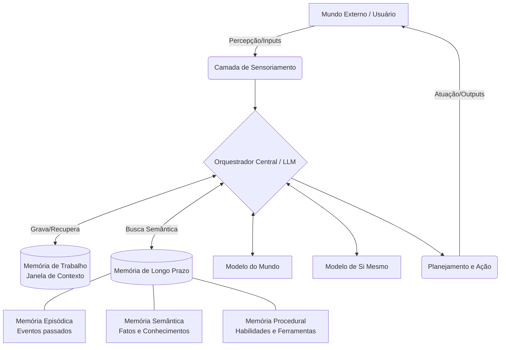

# 2. Arquitetura de Software

Para dar suporte aos requisitos teóricos, o Agente Cognitivo Persistente requer uma arquitetura que desacople o raciocínio reativo (LLM base) do armazenamento de estado e da percepção contínua.

## 2.1 Visão Geral dos Componentes

O núcleo do agente não é apenas um modelo que responde a *prompts*, mas um sistema orquestrado de vários subsistemas.

## 2.2 Subsistemas de Memória

A memória deve ser estruturada hierarquicamente para contornar os limites da janela de contexto.

*   **Memória de Trabalho:** O contexto atual do LLM. É volatil, de alta velocidade e foca estritamente na tarefa ou conversa atual.
*   **Memória Episódica:** Armazena logs de interações passadas ("No dia X, conversei com Y sobre Z e falhei em resolver a tarefa"). É tipicamente implementada usando Bancos de Dados Vetoriais (ex: ChromaDB, Pinecone) com recuperação via RAG (*Retrieval-Augmented Generation*).
*   **Memória Semântica:** Conhecimento factual consolidado. É a generalização das memórias episódicas ("Usuário Y prefere código em Python"). Pode ser modelada como um Grafo de Conhecimento.
*   **Memória Procedural:** Ferramentas, scripts e habilidades que o agente aprende a usar (APIs, comandos de terminal).

## 2.3 Modelo de Si Mesmo e Modelo do Mundo

Estes modelos funcionam como *prompts* dinâmicos injetados na memória de trabalho:

*   **Modelo de Si Mesmo (Self-Model):** Um arquivo de estado persistente e atualizável que contém o "perfil" do agente, suas limitações sistêmicas conhecidas, seus valores éticos centrais e seus objetivos de longo prazo.
*   **Modelo do Mundo (World-Model):** A compreensão atual do agente sobre o ambiente em que está operando (ex: estrutura do sistema de arquivos atual, estado da rede, regras da sociedade na qual ele atua).

## 2.4 Mecanismo de Atenção e Planejamento

A atenção atua como um filtro antes da recuperação na memória de longo prazo, decidindo o que é relevante para o contexto atual.
O planejamento é feito através de *Raciocínio Baseado em Árvore* (Tree of Thoughts) ou execução passo-a-passo (ReAct), onde o agente quebra tarefas maiores em sub-tarefas, verifica o Modelo de Si Mesmo para garantir capacidade de execução, e orquestra a ação.

---
**Anterior:** [1. Fundamentação Teórica](./01_Fundamentacao_Teorica.md) | **Próximo:** [3. Ciclo Cognitivo](./03_Ciclo_Cognitivo.md)
