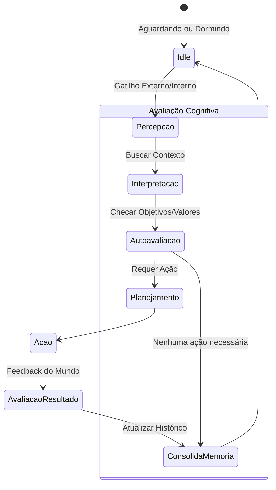

# 3. Ciclo Cognitivo

A operação de um Agente Cognitivo Persistente não é ativada apenas por requisições do usuário. Para simular autonomia, o agente executa um **Loop Contínuo** (eventualmente gerenciado pelo Metabolismo Computacional para poupar recursos).

## 3.1 O Loop Básico (OODA Loop Evoluído)

Inspirado no loop OODA (Observe, Orient, Decide, Act), o ciclo cognitivo do agente possui as seguintes etapas:

1.  **Percepção (Observe):** O agente captura inputs do ambiente. Pode ser uma mensagem do usuário, uma notificação de sistema, um alarme de timer, ou uma mudança em um banco de dados monitorado.
2.  **Interpretação (Orient - Contexto):** O input é codificado (embeddings) e cruzado com a Memória de Longo Prazo e o Modelo do Mundo para estabelecer significado.
3.  **Autoavaliação (Orient - Metacognição):** Antes de agir, o agente consulta o Modelo de Si Mesmo e seus Objetivos. "Isso é relevante para mim?", "Tenho as ferramentas para lidar com isso?".
4.  **Planejamento (Decide):** Se a ação é justificada, o agente elabora uma cadeia de passos lógicos, simulando potenciais resultados.
5.  **Ação (Act):** Execução da tarefa, seja responder via texto, usar uma API ou executar um script local.
6.  **Nova Experiência e Atualização de Memória:** O resultado da ação é percebido. O sucesso ou falha gera um log que passa por um processo de *Consolidação* (geralmente agendado para momentos de inatividade), atualizando a Memória Episódica e possivelmente ajustando o Modelo de Si Mesmo ou do Mundo.

## 3.2 Diagrama de Fluxo Cognitivo

## 3.3 A Importância da Passividade (Idle)

Ao contrário dos scripts padrão, o estado *Idle* (ocioso) não significa que o agente está morto. É durante o estado ocioso que processos em background (equivalentes ao "sono") analisam os logs recentes, fazem sumarizações para economizar espaço no vetor de contexto e reforçam conexões semânticas importantes.

---
**Anterior:** [2. Arquitetura de Software](./02_Arquitetura_Software.md) | **Próximo:** [4. Identidade e Propósito](./04_Identidade_e_Proposito.md)
