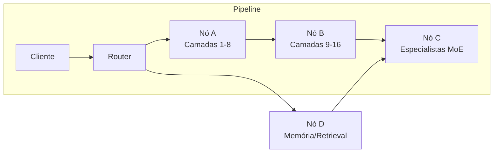
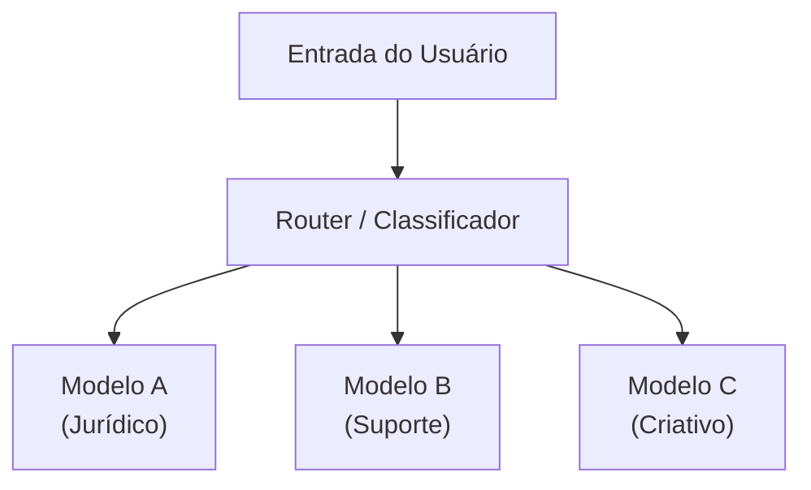
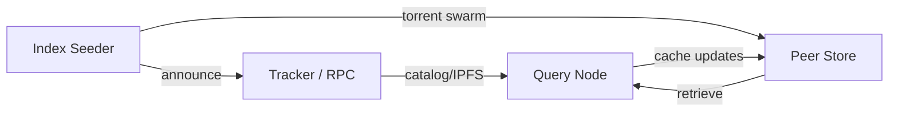
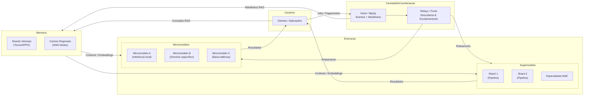

# Distributed Models and Micromodels: Pros, Cons, and Vector Storage

This document extends the whitepaper with technical alternatives for running and training language models in a decentralized network. We cover two core approaches—**distributed supermodel** and **specialized micromodels**—plus a proposal for **distributed storage of semantic vectors**.

---

## 1. Distributed Supermodel

### Overview

A large LLM is partitioned across different nodes. Each participant keeps a fragment of the model (weights, experts, layers) and executes specific forward/backward steps. The network behaves like a single logical model even though it is physically dispersed.



### Techniques

- **Pipeline parallelism** (Megatron, GPipe): each node hosts sequential layer blocks.
- **Federated Mixture-of-Experts**: experts live on different nodes; a router directs specific tokens to each.
- **Context parallelism**: long prompts are split and processed in parallel, later merged by an aggregator.

### Pros

| Advantage | Description |
| --- | --- |
| Horizontal scale | Capacity grows with the number of nodes, enabling models larger than any single server. |
| Specialization | Nodes can host experts trained for different domains, improving quality. |
| Weight reuse | Updates can ship as “patches” per shard. |

### Cons

| Limitation | Impact |
| --- | --- |
| Inter-node latency | Forward pass depends on multiple hops; requires low-latency links or aggressive caching. |
| Synchronization complexity | Needs robust protocols for ordering calls, handling timeouts, resends. |
| Intermediate security | Tensors might leak sensitive info; encryption or TEEs recommended. |

---

## 2. Specialized Micromodels

### Overview

Instead of one giant model, the network spreads many smaller models tuned for specific jobs (translation, summarization, support, etc.). A lightweight orchestrator—or the client itself—composes the final response.



### Pros

| Advantage | Description |
| --- | --- |
| Lower hardware needs | Each node can host a compact (≤7B) quantized model. |
| Lower latency | Inference is local, without multiple hops. |
| Natural diversity | The community publishes micromodels and competes on performance/accuracy. |

### Cons

| Limitation | Impact |
| --- | --- |
| Global coherence | Responses may diverge; alignment layers are needed. |
| Context reuse | Sharing history between micromodels is harder; requires shared memory. |
| Version management | Many models require cataloging and reputation tracking. |

---

## 3. Distributed Storage of Semantic Vectors (RAG over Torrent/IPFS)

### Goal

Keep embeddings and vector indexes (ANN) in a decentralized, replicable, auditable way, powering Retrieval-Augmented Generation.

### Proposed Architecture



1. **Embedding generation**: a job produces vectors (`float16`/`int8`), builds an ANN index (FAISS/HNSW), and packs everything into `.tar` blocks with metadata (hash, schema, license).
2. **Distribution**: blocks are shared via BitTorrent or libp2p Bitswap; a matching manifest is published on Nostr/IPFS with the torrent hash, version, and update policy.
3. **Query**: RAG-serving nodes cache these indexes locally. Upon a query, they check which shards they hold and may forward requests to other peers if needed.
4. **Update**: deltas (new embeddings) go out as incremental torrents or Merkle patches, enabling partial refresh without re-downloading the entire index.

### Pros

- **Resilience**: anyone can seed indexes; losing a node does not kill availability.
- **Auditability**: hashes and manifests make content verifiable; researchers can reproduce results.
- **Horizontal scale**: large indexes (100+ GB) can be split into smaller shards; clients fetch only what they need.

### Cons

- **Privacy**: embeddings may leak data; anonymization policies are required before distribution.
- **Version consistency**: multiple seeders might publish different versions; manifests need signatures and version numbers.
- **Query latency**: remote shards add latency; regional caches are preferable.

### Suggested Package Layout

```
index-shard/
 ├── metadata.json   # hash, versão, schema, licença, bounding boxes
 ├── vectors.f16     # embeddings quantizados (MMAP-friendly)
 ├── ids.bin         # IDs originais
 ├── faiss.index     # índice ANN
 └── signatures/     # assinaturas dos produtores e validadores
```

---

## 4. Comparative Table

| Feature | Distributed Supermodel | Specialized Micromodels | Distributed Vectors (RAG) |
| --- | --- | --- | --- |
| Latency | High (network-bound) | Low/local | Medium (depends on caching) |
| Parameter scale | Virtually unlimited | Limited by local hardware | N/A (stores indexes) |
| Operational complexity | High (sync, routing) | Medium (model catalog) | Medium (shard ops) |
| Fault tolerance | Needs redundancy/pools | High (fallback to another model) | High (torrent/IPFS replication) |
| Data privacy | Sensitive (intermediate tensors) | Better (local execution) | Sensitive (embeddings need anonymization) |
| Ideal scenarios | Global training, complex instructions | Regional services, specific tasks | Assistants with external memory, multimedia search |

---

## 5. Recommendations

1. **Short term**: bootstrap specialized micromodels for low latency and easy onboarding on small GPUs.
2. **Medium term**: add distributed parallelism modules (MoE/Pipeline) for workloads demanding giant models.
3. **Collective memory**: standardize embedding/index shard formats so anyone can host a “RAG torrent.”
4. **Security**: require digital signatures and integrity checks on every block (weights, experts, embeddings) to prevent supply-chain attacks.
5. **Technical governance**: define lightweight specs for (a) expert routing, (b) micromodel manifests, (c) vector shard manifests.

With these building blocks, the network can support both “planet-scale supermodels” and intimate micromodels, always backed by a shared layer of distributed vector memory.

---

## 6. Integrated Blueprint (Final View)



This diagram summarizes the recommended architecture: clients publish jobs and payments to the coordination layer; relays/pools route each job to micromodels or distributed supermodel shards; both consult the vector memory layer for extra context; manifests and torrents keep everything open for upgrades; and every component stays interoperable through public protocols.

